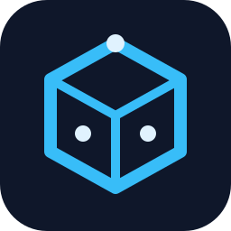
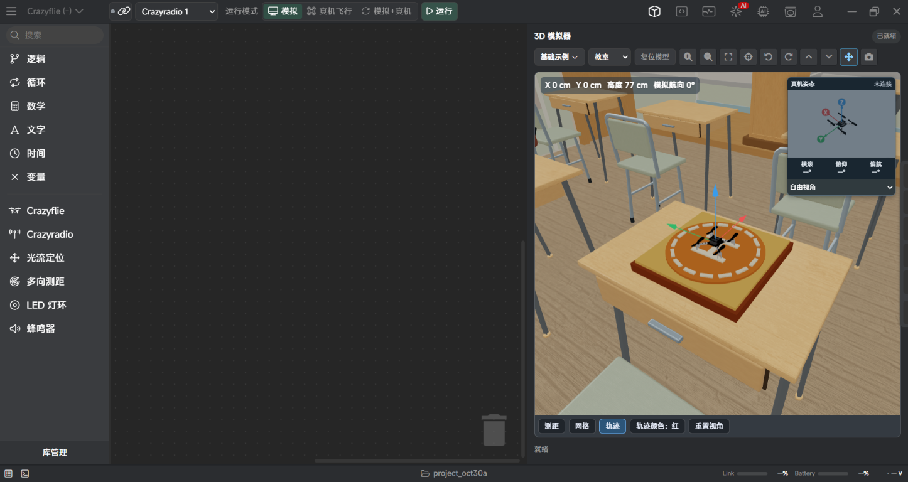

# RobotSTEM



[English](./README.md) | 中文

**面向开源机器与物理世界的 AI 编程平台，让代码走进真实世界。**

RobotSTEM 将积木编程、三维模拟、真机控制与 AI 辅助结合在一个桌面应用中，面向 STEM 学习、课堂探索和物理世界的原型开发，长期方向是服务多种形态的开源机器与机器人。

**Crazyflie 开源飞行器是 RobotSTEM 接入的第一种机器，而不是平台的边界。** 后续会逐步接入更多机器，包括开源小车、机械臂等；这些只是扩展方向的例子，并非完整设备清单，也不代表已经支持。产品以机器及其与物理世界的交互为中心，不再以 Arduino、ESP32 等通用开发板目录为入口。

## 平台通用能力

| 能力 | 当前功能 |
| --- | --- |
| 积木编程 | 使用 Blockly 表达程序逻辑，包括循环、条件、数学、文字、时间和变量。 |
| AI 辅助 | 保留 AI 对话、编程辅助、大模型选择和自定义模型配置；生成内容需要人工检查后使用。 |
| 工程与账户 | 管理本地工程及依赖，并保留账户登录、云端工程和云端模板能力。 |
| 物理世界交互 | 在一个应用中连接编程、模拟反馈与设备交互；具体控制功能由已经完成的机器适配提供。 |

账户、AI 和云端功能依赖对应服务及账号、模型配置。随着平台扩展，后续机器适配会逐步带来各自的控制能力、模拟环境与交互方式。

## 首个机器案例：Crazyflie

Crazyflie 是当前第一个完成接入的机器，也是 RobotSTEM 连接编程与物理世界的一个具体案例。下面的截图和功能描述属于这一适配案例，不代表平台只能服务飞行器。



*平台当前案例界面：Crazyflie 积木分类、三维教室及飞行器姿态预览。截图处于模拟模式，未连接真机。*

| Crazyflie 案例能力 | 当前实现 |
| --- | --- |
| 运动编程 | 结合平台基础积木与 Crazyflie 运动积木搭建程序。 |
| 三维探索 | 提供教室、家庭和主题场景，离线中国/世界地图，探索任务、视角控制及飞行轨迹展示。 |
| 模拟与真机 | 支持纯模拟、真机飞行，以及根据真实遥测更新三维视图的模拟+真机模式。 |
| 硬件与扩展 | 提供 Crazyradio 连接配置、链路/电池状态，以及已适配的光流定位、多向测距、LED 灯环和蜂鸣器积木；硬件功能需要对应扩展模块。 |

仅体验这一案例的模拟器不需要 Python、Crazyradio 或飞行器。

## 机器接入进展

| 机器 / 设备 | 状态 |
| --- | --- |
| Crazyflie / Crazyradio | 首个已接入设备；真机功能使用 Python 与 cflib，运动需要光流定位等可用定位能力。 |
| 开源小车 | 后续接入方向之一，尚未提供可选设备适配。 |
| 开源机械臂 | 后续接入方向之一，尚未提供可选设备适配。 |
| 更多开源机器 | 持续扩展方向，完成适配前不视为已支持。 |

新建工程、设备切换和 AI 设备目录统一使用随应用提供的 Crazyflie 资源。保留的底层兼容代码不代表本分支已支持其他开发板。

## 当前 Crazyflie 运行模式

| 模式 | 行为 |
| --- | --- |
| 模拟（默认） | 仅在模拟器中执行，不发送真机控制指令。 |
| 真机飞行 | 用户明确选择模式并启动程序后，通过 Python/cflib 执行控制指令。 |
| 模拟+真机 | 执行真机控制，并依据真实遥测更新三维视图；不是“仿真通过后自动放行实飞”。 |

**安全提示：** 请先在模拟模式下验证程序。真机运行前检查链路、电量、定位和周围净空；自检与电机测试积木可能驱动电机，测试前请卸下螺旋桨。仿真结果和 AI 输出不能证明真实飞行安全，本项目不是经过安全认证的飞控系统。

Crazyflie 积木程序由电脑端应用通过 Python/cflib 发送控制指令，不会编译为可脱离电脑运行的飞行器固件，也不会因运行工程而自动刷写固件。

## 快速开始

以下以 **Windows PowerShell** 为例，请先安装 Node.js、npm 和 Git。

```powershell
git clone --branch RobotSTEM https://github.com/bitdeckai/aily-blockly.git
Set-Location aily-blockly
npm install
npm install --prefix electron
npm run electron
```

开发时请保持启动终端运行。该命令会启动 Angular 开发服务，等待 4200 端口就绪后打开 Electron；只用浏览器打开前端页面不具备桌面硬件 IPC 能力。

**首次体验机器接入案例（以 Crazyflie 为例）：**

1. 新建项目，选择 **Crazyflie**。
2. 拖入积木，或选择基础示例中的自检、悬停、前后移动、方形航线。
3. 保持 **模拟** 模式，点击 **运行**。
4. 先观察三维场景、轨迹及执行日志，再考虑真机操作。

### 可选：连接真机

安装 Python 3.10 或更高版本，并在应用实际使用的解释器中安装 cflib：

```powershell
py -3 -m pip install --upgrade cflib
py -3 -c "import cflib; print(cflib.__file__)"
```

连接 Crazyradio，配置兼容的 USB 驱动，并核对飞行器 URI 与地址。实际操作前请阅读 [Crazyflie 环境配置、安全说明与排错指南](./README_crazyflie.MD)。

## 开发与构建

| 命令 | 用途 |
| --- | --- |
| `npm run electron` | 编译并启动完整桌面开发版。 |
| `npm run start` | 仅启动 Angular 前端。 |
| `npm run ng -- build --configuration development` | 构建前端，不启动 Electron，也不生成安装包。 |
| `npm run build` | 构建生产版前端并制作桌面安装包。 |
| `npm run build:desktop` | 构建并检查当前系统及 CPU 的安装包，输出到 `dist/installers/`。 |
| `npm run package:all` | 通过原生 GitHub runner 一键构建 Windows、Linux、Mac Intel/Apple Silicon，等待并下载安装包；需先提交、推送并登录 `gh`，不发布或部署。 |

完整回归另需可用的 Python 3。在 PowerShell 中执行：

```powershell
$tests = Get-ChildItem .\scripts -Filter 'test-*.cjs' -File
node --test $tests.FullName
```

上述回归不会执行真机飞行。区域渠道与平台打包细节见 [Crazyflie 开发指南](./README_crazyflie.MD) 和 [通用开发说明](./develop.md)。

## 显示器与界面缩放

- 默认跟随系统 DPI，不根据分辨率强制修改整页缩放；可用 `Ctrl/Cmd +`、`Ctrl/Cmd -` 调整界面，`Ctrl/Cmd 0` 恢复默认。
- Windows 启动时将窗口恢复到显示器工作区内，最小尺寸随工作区约束；跨屏、调整显示设置或移除显示器后重新检查，同时保留正常的跨屏拖动。
- 窗口变窄时工具箱让出编辑空间，回到宽窗口后恢复拖动偏好；极窄编辑区提供横向滚动，短窗口中的模拟面板和任务区域可滚动访问。
- 三维渲染随 DPI 变化刷新清晰度，像素比上限为 2，以控制显卡开销；不会重置观察视角。

显示适配回归（不连接硬件）：

```powershell
node --test scripts\test-window-startup.cjs scripts\test-display-adaptation.cjs
```

已通过真实模板、样式与 WebGL 渲染器的 52 组浏览器模拟验证，覆盖 640×360 至 3840×2160 的有效视口、100%/125%/150%/200% DPI 和更高 DPI 的像素比上限保护。这不替代多台物理显示器上的跨屏实测。

## 兼容与后续方向

- **继续保留：** 账户登录、AI 与模型配置、云端能力、已有用户数据和旧工程加载兼容。
- **兼容标识：** `.abi`、OAuth 回调、`@aily-project` 包名及部分内部路径不机械改名，避免破坏已有数据和服务。
- **更新通道：** 独立更新源配置完成前，上游自动更新停用。
- **平台方向：** 从首个 Crazyflie 适配逐步扩展到更多开源机器，小车与机械臂是例子，不是平台的范围上限。
- **后续工作：** 面向更多机器逐步适配编程、模拟与真机交互能力，在保留有效兼容能力的前提下解耦旧共享工具链。

## 文档与反馈

- [English introduction](./README.md)
- [Crazyflie 开发、模拟与排错指南](./README_crazyflie.MD)
- [通用开发说明](./develop.md)（上游参考文档，部分内容描述原平台）
- [问题反馈](https://github.com/bitdeckai/aily-blockly/issues)
- [Crazyflie 官方文档](https://www.bitcraze.io/documentation/)

欢迎提交其他机器的接入需求、交互方式及教学场景建议。反馈问题时请附操作系统、复现步骤及脱敏日志，不要上传账户凭据或模型 API 密钥。

## 开源与致谢

RobotSTEM 基于 [ailyProject/aily-blockly](https://github.com/ailyProject/aily-blockly) 开发，保留原作者版权、许可证、赞助归属及服务声明。GPL-3.0 许可证见 [LICENSE](./LICENSE)，上游附加权利说明保留如下。

主要技术包括 [Electron](https://github.com/electron/electron)、[Angular](https://github.com/angular/angular)、[Blockly](https://github.com/google/blockly)、[Three.js](https://github.com/mrdoob/three.js)、[Node.js](https://github.com/nodejs/node) 和 [cflib](https://github.com/bitcraze/crazyflie-lib-python)。保留的工具链还使用了 [7z](https://github.com/sparanoid/7z) 与 [probe-rs](https://github.com/probe-rs/probe-rs)；AI 功能参考了 [Kode](https://github.com/shareAI-lab/Kode-cli) 和 [Copilot](https://github.com/microsoft/vscode-copilot-chat)。其他依赖见 [package.json](./package.json) 及 [Electron 依赖](./electron/package.json)。

## 附加权利说明  
1. 本软件为GPL协议下的免费软件，在无授权的情况下，不得销售本软件及基于本软件的衍生软件；
2. 使用本软件开发的硬件作品不受GPL限制，用户可自行决定发布和使用方式；
3. 基于本软件的衍生品，不得移除本项目相关权利人、赞助者信息，且必须保证相关信息出现在软件启动页；
4. 在无授权的情况下，不得移除本项目附带的线上服务内容、及用户协议。

## 上游项目赞助归属

以下保留上游项目的赞助信息，不代表相关机构已赞助或认可 RobotSTEM 独立分支。

### 企业赞助

<table>
  <tr>
    <td><a target="_blank" href="https://www.seeedstudio.com/"></a></td>
    <td><a target="_blank" href="https://www.seekfree.cn/"></a></td>
    <td><a target="_blank" href="https://www.diandeng.tech/"></a></td>
    <td><a target="_blank" href="https://www.openjumper.com/"></a></td>
  </tr>
  <tr>
    <td><a target="_blank" href="https://www.pdmicro.cn/"></a></td>
    <td><a target="_blank" href="https://www.titlab.cn/"></a></td>
    <td><a target="_blank" href="https://www.emakefun.com"></a></td>
    <td><a target="_blank" href="http://www.keyes-robot.com/"></a></td>
  </tr>
</table>

### 个人赞助

陶冬(天微电子) | 夏青(蘑菇云创客空间) | 杜忠忠Dzz(社区伙伴) | 李端(益学汇) | 孙俊杰(社区伙伴)

### 技术赞助

<table>
  <tr>
    <td><a href="https://signpath.io/"></a></td>
    <td>由 <a href="https://signpath.io/">SignPath.io</a> 提供 Windows 免费代码签名，证书由 <a href="https://signpath.org/">SignPath Foundation</a> 颁发</td>
  </tr>
</table>
